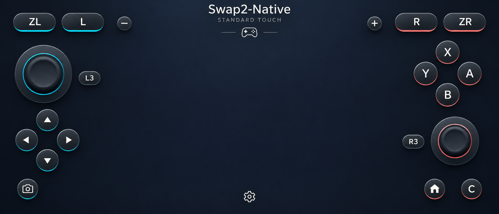

# Standard touch controls v2 — Claude implementation handoff

Status: visual layout approved by the user on 2026-11-06. **Implemented in the launcher's Classic profile on 2026-11-06** (`TouchControls`, `TouchProfile`, `drawable-nodpi/s2_standard_controls_v2.png`). Java compilation and the automated touch checks pass. No APK has been built or installed, and phone validation (the acceptance checklist below) is pending. What was implemented, and where it departs from the letter of this handoff, is in [touch profiles: standard skin v2](SWAP2-NATIVE-TOUCH-PROFILES.md#standard-skin-v2-classic). The game-specific Bananza, Racing and Zelda profiles are unchanged.

## Approved appearance and files

Graphite button caps, white glyphs, fine gray rims, cyan left-side accents and coral right-side accents. Original raster artwork inspired by the Switch 2 controller arrangement. No console shell, thick rings or glass bubbles. Keep the play area clear. The title, subtitle and background in the presentation are reference decoration: do not draw them over gameplay.

All deliverables are in [standard-touch-v2](../assets/artwork/swap2-native/standard-touch-v2/):

| File | Purpose |
|---|---|
| `standard-touch-layout-v2.png` | Approved 1913x822 visual reference |
| `standard-touch-atlas-v2-clean.png` | Selected 1254x1254 RGBA atlas, 25 separate sprites |
| `sprites-v2.json` | Measured source rectangles, Android Rect convention: right/bottom exclusive |
| `layout-reference-v2.json` | Reference centers, sizes, horizontal anchors and optional visibility |
| `PROMPTS.md` | Final generation prompts and provenance; built-in image_gen used |
| `standard-touch-atlas-v2.png` | Unselected first draft with excessive background haze; DO NOT bundle |

Use the **clean** atlas. Its corner and inter-sprite gutter pixels were verified transparent. The generator did not produce perfectly uniform grid spacing: use `sprites-v2.json`, not `width / 5` cropping. Rectangles are deliberately bounded to individual silhouettes; preserve per-pixel alpha and aspect ratio. Do not stretch the preview as a full-screen bitmap.

## Integration points

Current code: [TouchControls.java](../android/app/src/main/java/dev/nxnative/android/TouchControls.java), [TouchProfile.java](../android/app/src/main/java/dev/nxnative/android/TouchProfile.java), and [touch profile documentation](SWAP2-NATIVE-TOUCH-PROFILES.md). The existing Classic path draws procedural circles/labels; Bananza, Racing and Zelda have separate artwork paths. Route the new standard atlas only through Classic/default fallback. Keep existing semantic input mappings, preference scope, user edits, automatic profile selection and the physical gamepad hide/show behavior.

1. Bundle the selected PNG as `android/app/src/main/res/drawable-nodpi/s2_standard_controls_v2.png`. Keep the source atlas and manifest in assets/artwork for maintenance.
2. Decode once with `BitmapFactory.Options.inScaled = false`. Reuse `Paint`, source `Rect` and destination `RectF`; no image decode or per-frame file access in `onDraw`.
3. Map by stable semantic sprite ID, never by displayed text or atlas cell guessed from label. Import the measured rectangles into a small immutable Java lookup or generated resource table.
4. Draw each button with `Canvas.drawBitmap(atlas, src, dst, paint)`, centered and aspect-preserving. Existing themed paths continue to use their own resources.
5. Draw each analog base and thumb cap separately. Move only the cap from the current stick vector; keep the base fixed. With the reference sizes, cap travel up to 26 reference pixels left / 22 right keeps the cap within its base. Scale travel with the stick. Center both on release/cancel.
6. For the D-pad, render four separated direction sprites, arranged as a diamond. Preserve correct simultaneous directions and diagonal input. If the implementation keeps the existing DPAD input region, reconcile its geometry with the rendered positions; if it uses four button regions, keep them in one editable group. Do not create dead visual buttons or suppress diagonal combinations.
7. The visibility sprite replaces the current procedural show/hide glyph. Preserve long-press to open controls settings. The gear opens the same existing application controls/settings panel and sends no guest controller button.

## Input mapping and optional assets

The host ABI is defined in [dm_input.h](../dm/host/dm_input.h). No new controller bits are needed for the standard skin.

| Sprites | Existing guest input |
|---|---|
| `a`, `b`, `x`, `y` | A bit 0, B bit 1, X bit 2, Y bit 3 |
| `l3`, `r3` | Stick click bits 4 and 5 |
| `l`, `r`, `zl`, `zr` | Bits 6, 7, 8, 9 |
| `plus`, `minus` | Bits 10, 11 |
| `left`, `up`, `right`, `down` | Bits 12, 13, 14, 15 |
| `left_stick_base` + `left_stick_cap` | Existing stick 0 axes |
| `right_stick_base` + `right_stick_cap` | Existing stick 1 axes |
| `visibility`, `settings` | Application UI actions; no guest input |
| `capture`, `home`, `c` | Optional artwork only; hidden initially |

**Home, capture and C are not present in the current 16-button guest ABI.** Do not invent bits, alias them to Plus/Minus or imply GameChat support. Leave these three hidden in the first implementation. They can later be exposed for explicitly defined application actions. The preview includes them to provide a complete visual kit; hiding them does not prevent implementing this standard skin now.

Nintendo face-button order is mandatory: X top, Y left, A right, B bottom. Left stick high / D-pad low; ABXY high / right stick low. L3/R3 remain small independent touch targets near their own sticks.

## Responsive geometry, editing and safe areas

`layout-reference-v2.json` records the approved landscape reference at 1913x822. It is a placement reference, not a fixed screenshot-sized runtime surface.

- Use the full overlay view's safe content rectangle, independent of the game's letterboxed image rectangle. Respect actual cutouts/gesture edges without recreating permanent sidebars. Hit testing and drawing must use the same origin and scale.
- Base scale `u = safeHeight / 822 * userSize`. Left-anchored x is `safeLeft + xRef*u`; right-anchored x is `safeRight - (1913 - xRef)*u`; center controls use safe rectangle center. Top-based y is `safeTop + yRef*u`. Widths and heights scale by u, with source aspect preserved inside the target box.
- The positions are starting points. Fit the existing editable groups within the safe rectangle at the chosen size. Clamp or proportionally reduce a preset if its groups would overlap on a narrow display; never push a button outside reachable bounds. Do not scale artwork anisotropically to fit.
- Preserve custom positions already saved by the user. Use the new geometry as the default for a fresh standard layout or explicit Restore defaults. If a layout namespace migration is necessary, preserve existing data and document its key; do not reset per-game settings on launch.
- Landscape 16:9, 20:9 and 21:9 must work. Portrait keeps the existing supported layout behavior while using the new art where practical; do not force the landscape reference onto portrait.
- Keep minimum practical touch targets around 44-48 dp where space permits; visual glyph size and hit target can differ. Keep adjacent hits unambiguous. App utility controls should not steal a held stick or face button.

## Pressed, disabled and motion states

The atlas contains neutral artwork. Implement state feedback in Canvas; no second atlas is required:

- Idle: use the existing user's opacity; 65% is the suggested fresh-install value, not a forced reset.
- Held: subtle white/cyan/coral highlight and up to 1.03x visual scale, with a stable hit region. Raise opacity modestly without exceeding 100%; do not wash out the label.
- Release: 90-120 ms return animation. Reduced motion disables scaling/fades. Use existing haptic preference; add no new sound dependency.
- Disabled optional action: hide it rather than showing a clickable-looking button with no function.
- Compose source alpha with user opacity. Do not apply dark or colored rectangular tiles behind the sprites. Test the atlas over both light and dark gameplay; a transparent viewer preview alone is not sufficient.
- Multi-touch is essential: movement + camera + face/shoulder holds must work together. Pointer-up and ACTION_CANCEL/focus loss must release exactly the relevant held inputs. Do not alter input timing or automate button combinations.

## Acceptance checklist

Before shipping the APK, Claude should verify:

- Every measured sprite is visible, uncropped, undistorted, and maps to its intended glyph; no atlas haze or adjacent sprite leaks. Both analog caps move independently over their own bases.
- All 16 existing guest button bits and both stick axes remain reachable. Check ABXY placement, L/ZL/R/ZR, stick clicks, D-pad diagonals and simultaneous holds. No fake Home/C/capture mapping.
- Standard/default games use this skin; DK, Mario Kart and Zelda still use their approved themed art when selected. Explicit Classic selection uses the new standard skin.
- Existing size, opacity, vibration, per-game customization, restore defaults, edit groups, double taps/long presses and gamepad auto-hide continue to work.
- At least 16:9/20:9/21:9 plus portrait, scale min/max, opacity min/max, display cutout, insets and full-screen dragging. Keep utilities inside safe touch bounds and avoid overlaps at extreme scale.
- Rotate, background/resume, release an active pointer, attach/detach a gamepad, and reopen the game; no stuck inputs or resource/decode crash.
- Build and run existing touch profile/input tests appropriate to the implementation, then visually inspect on the actual phone over light and dark scenes. Artwork approval is not gameplay validation.

No host, shader, packer or preparation change is part of this visual handoff.
