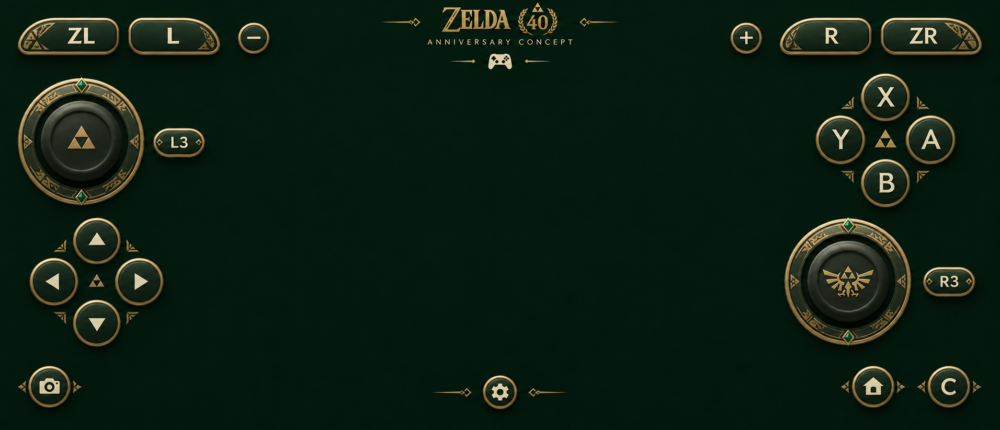

# Zelda 40th Anniversary touch skin — Claude implementation

Date: 2026-11-06. The user approved the green/gold layout and requested transparent artwork for the Zelda profile. This handoff supplies artwork and implementation specifications.

Status: **implemented in the launcher's Zelda profile on 2026-11-06** (`TouchProfile.Skin` / `ZELDA40_SKIN`, `TouchControls`, `drawable-nodpi/s2_zelda40_controls.png`). Java compilation and the automated touch checks pass. No APK has been built or installed, and phone validation (the acceptance list below) is pending. What was implemented, and where it departs from the letter of this handoff, is in [touch profiles: Zelda 40th anniversary skin](SWAP2-NATIVE-TOUCH-PROFILES.md#zelda-40th-anniversary-skin).

## Approved result and deliverables

Use the original commemorative forest-green/champagne-gold skin. Buttons retain controller letters; analog caps carry the Triforce and winged Hylian crest. The center remains clear. The presentation's background, title and ornamental connecting lines are not runtime overlay elements.

The [artwork folder](../assets/artwork/swap2-native/zelda-40/) contains:

| File | Use |
|---|---|
| `zelda-40-touch-concept-v1.png` | Approved 1912x823 landscape composition |
| `zelda-40-touch-atlas-v1.png` | Selected 1263x1245 RGBA PNG with 25 sprites and transparent background |
| `sprites-v1.json` | Measured source rectangles, right/bottom exclusive, suitable for Android Rect |
| `layout-reference-v1.json` | Starting centers, target sizes, anchors, skin/profile IDs and optional controls |
| `ATLAS-PROMPT-v1.md` | Selected atlas prompt and built-in image_gen provenance |
| `PROMPT-v1.md` | Approved concept prompt |

The atlas is not square and its objects are not an exact uniform tile grid. **Use the measured rectangles and actual image dimensions. Never copy the Classic atlas's 1254-pixel constant or crop by width / 5.** Draw with source alpha; do not flatten onto black or treat nearly transparent RGB edge pixels as opaque. Both sampled empty-background pixels and corner alpha were checked; validate native rendering over light and dark scenes before shipping.

## Scope and routing

- Zelda title ID: `0400486024DEC000`.
- Keep `TouchProfile.ZELDA = "zelda-oot"` and the existing automatic routing. This is the Zelda profile's new default visual skin, not a new game's profile.
- Do not apply this atlas to Classic/default, Bananza or Racing. Explicit Classic on Zelda continues to use the standard graphite/cyan/coral skin.
- Change presentation and fresh/default placement only. Retain the existing guest input ABI, control semantics, preparation/backend behavior and lifecycle.

Read [TouchProfile.java](../android/app/src/main/java/dev/nxnative/android/TouchProfile.java), [TouchControls.java](../android/app/src/main/java/dev/nxnative/android/TouchControls.java), and [current touch profile notes](SWAP2-NATIVE-TOUCH-PROFILES.md). The standard v2 renderer has now been implemented: `standardAtlas`, `standardSpriteFor`, `TouchProfile.placeStandard`, independent stick caps, eight-way D-pad, application gear, held/release feedback. Reuse/generalize that renderer via a skin descriptor containing bitmap, dimensions, rectangles, palette and placement rather than duplicating its whole path. Its sprite IDs match this atlas's IDs, but its pixel rectangles and geometry do not.

Bundle the selected PNG as `android/app/src/main/res/drawable-nodpi/s2_zelda40_controls.png`, decoded once with `inScaled=false`. Use immutable source rectangles, a reusable Canvas/Paint path and aspect-preserving destinations. No bitmap decode, file reads or sprite extraction per frame.

## Preserve inputs and semantic IDs

Use the existing Zelda control IDs for stored settings and input behavior:

| Current Zelda action | New sprite | Guest value |
|---|---|---|
| `move` | `left_stick_base` + `left_stick_cap` | Left stick axes, stick 0 |
| `camera` | `right_stick_base` + `right_stick_cap` | Right stick axes, stick 1 |
| `face_a` | `a` | A, bit 0 |
| `face_b` | `b` | B, bit 1 |
| `slot_x` | `x` | X, bit 2 |
| `slot_y` | `y` | Y, bit 3 |
| `left_click` | `l3` | StickL, bit 4 |
| `right_click` | `r3` | StickR, bit 5 |
| `shoulder_left` | `l` | L, bit 6 |
| `shoulder_right` | `r` | R, bit 7 |
| `trigger_left` | `zl` | ZL, bit 8 |
| `trigger_right` | `zr` | ZR, bit 9 |
| `plus` | `plus` | Plus, bit 10 |
| `minus` | `minus` | Minus, bit 11 |
| `directions` | `left`, `up`, `right`, `down` | Existing D-pad group, bits 12..15 |

The letters deliberately avoid asserting remake-specific sword/bow/action bindings. The game continues to decide what each controller button does. Never remap bits to match an assumed weapon icon.

The old Zelda atlas uses a 4x4 action-icon table and saved `zelda_icon_<action>@<title ID>` values. Those indices **do not address this atlas**. Do not pass them into the new rectangle lookup. Preserve their stored values and the previous resource for compatibility; the anniversary skin uses fixed controller glyphs. Hide/disable the old action-symbol picker in this skin unless a separate explicit legacy-symbol option is implemented. Changing artwork must not silently erase the user's old icon choices.

## Geometry and application controls

The approved layout is asymmetric: left stick high, D-pad low; ABXY high on the right, right stick below. ABXY must be X top, Y left, A right, B bottom. L3/R3 are independent pill buttons, not labels painted over a stick.

`layout-reference-v1.json` is the source of initial geometry. It includes absolute reference centers on the 1912x823 presentation canvas and the left/right/center anchor for each element. Adapt using the full view's safe rectangle, independent of the letterboxed game image. Use the same transform for rendering, hit testing and editing.

For nominal 100% size, `u = safeHeight / 823`. Left x is `safeLeft + xRef*u`; right x is `safeRight - (1912-xRef)*u`; center controls align to the safe area's center. Preserve distance from the top for upper groups and from the bottom for lower groups when user scale changes, following the implemented standard renderer. Fit groups proportionally on narrower displays without stretching artwork or moving controls out of bounds. Reference sizes are art sizes, not permission to shrink touch targets below practical 44-48 dp bounds. Resolve hit overlaps consistently with the current host.

- Bases remain fixed. Caps are separate sprites and move from the existing stick vectors. Both reference bases are 244 units across, caps 162; travel up to 28 reference units keeps each cap inside its base. Center caps on release/cancel. Preserve analog dead zones and input range.
- Draw four D-pad buttons around the existing eight-way region, maintaining diagonal combinations and per-direction held feedback. Do not accidentally add a large decorative center as a fifth input.
- Use `visibility` for the existing show/hide control; preserve long-press settings and physical-gamepad auto-hide. `settings` opens the existing controls panel, and does not send Plus or any guest input.
- `capture`, `home`, and `c` are supplied as optional visual assets only. Keep them hidden initially: the current guest ABI has no corresponding buttons. Do not invent bits, alias them to Plus/Minus, or imply GameChat works. They can later be assigned explicitly implemented application actions.
- The PNG has no connecting decorations around ABXY/D-pad: separate button sprites keep touch targets clear. Do not recreate the presentation's background or anniversary title over gameplay.

Keep user-customized Zelda geometry until an explicit Restore defaults. A new namespace such as `v2/<title ID>/zelda-40/<screen>` can hold fresh anniversary defaults; read/preserve old `v1/<title ID>/zelda-oot/<screen>` edits when appropriate, without deleting them. Changing the profile's visual default must not reset opacity, size, vibration, visibility or picture placement. Portrait should reuse supported portrait placement with the new art, not squeeze the landscape reference into a narrow column.

## State feedback

Use the existing opacity and size controls. Suggested fresh default: 65% opacity. Neutral sprites are supplied; draw pressed feedback in Canvas with a restrained warm-gold/ivory highlight, up to 1.03x art-only scale and a short 90-120 ms return. Hit targets stay stable. Reduced motion disables scale/fade; haptics follow the saved preference. Do not use the standard skin's cyan/coral pressed tint on this green/gold skin.

Draw sprites at their measured aspect ratio inside the target shape. Preserve alpha when tinting so no colored rectangles appear behind a button. No additional sounds, host macros or timed input combinations are part of this handoff.

## Acceptance before delivery

1. New atlas decodes at 1263x1245 with all 25 rectangles in bounds and the correct glyph for each semantic ID. Compare alpha-composited buttons over bright and dark gameplay, including gold edges and engravings. No adjacent-sprite leaks, stretched pills or full-sheet background.
2. Zelda automatic/profile selection uses the new art. Explicit Classic, DK and Mario Kart still use their own skins. No old action-icon index is used as an anniversary atlas index.
3. All 16 existing button bits and both axes remain reachable, with correct Nintendo face order. Test L/ZL/R/ZR, stick clicks, diagonal D-pad, movement + camera + multiple held buttons, release/cancel/focus loss and gamepad attach/detach. No fake Home/C/capture input.
4. Both analog caps move independently and stay on their bases; they recenter on release. Visibility/gear and long-press open the correct app panel without guest input or stealing an existing held pointer.
5. Check 16:9, 20:9, 21:9, portrait, safe cutout, available size/opacity extremes and reduced motion. Check resize/rotate, full-screen bounds, custom old Zelda layouts, drag/pinch/reset and persistence after restart.
6. Extend the existing touch profile/sprite tests with the Zelda descriptor, matching the JSON tables and testing the profile-specific mapping. Build Java/resources, then visually inspect on the phone. Compilation and artwork approval do not prove received game input or gameplay correctness.

The atlas, manifest, reference placement and local links were validated for this handoff. Runtime implementation, APK generation/installation and phone verification remain Claude's work.
